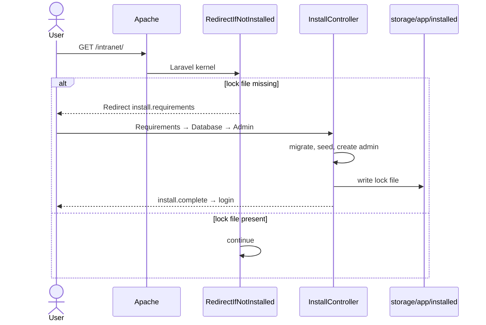
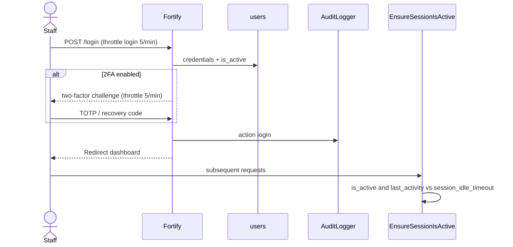
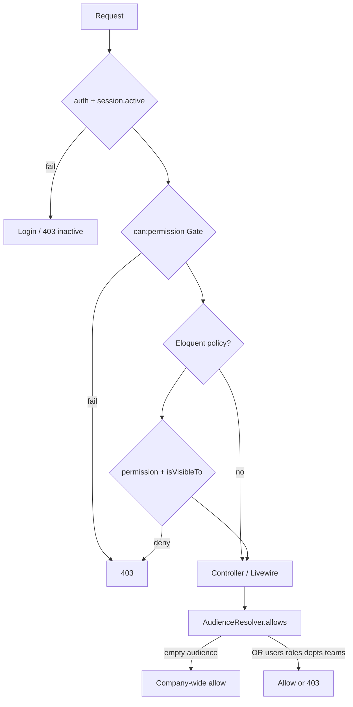
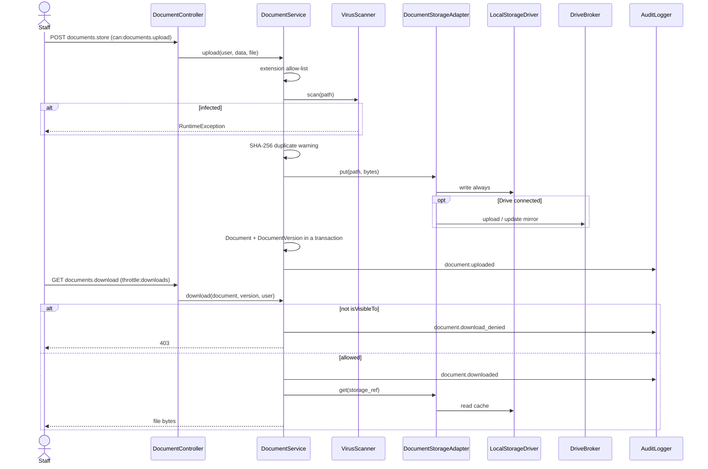
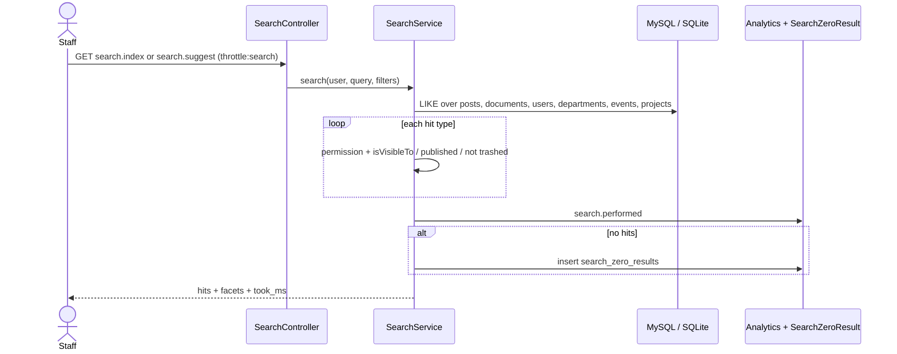
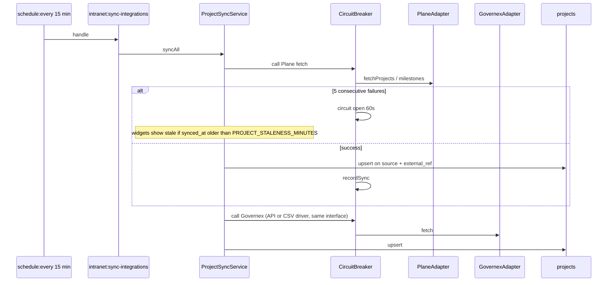
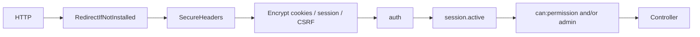

# Runtime flows

Sequence diagrams for the paths that implement authorisation, storage, and integrations. Companion to [TECHNICAL.md](TECHNICAL.md).

URLs assume the XAMPP Alias (`APP_URL=http://localhost/intranet`). Route **names** are what the code uses.

---

## 1. First-run install



---

## 2. Local login and session



SSO (`GET /sso/callback/{provider}`) uses `SsoAdapter`, matches email to a pre-provisioned active user, audits `sso.login`, and refuses unknown accounts. Provider `local` is rejected on this route.

---

## 3. Authorisation (every module page)



Search repeats `isVisibleTo` (or equivalent) **inside** `SearchService` so hits never leak in JSON typeahead.

---

## 4. Document upload and download



Listings and ACL never call Drive. Local disk is the serve path. `DriveBroker::resolve()` exists to fill cache from a Drive revision when needed.

---

## 5. Staff information (self vs admin lock)

```mermaid
sequenceDiagram
    actor Staff
    actor Admin
    participant Self as StaffInformationController
    participant Svc as StaffInformationService
    participant Model as StaffInformation
    participant Disk as public disk

    Staff->>Self: POST directory.staff-information.update
    Self->>Svc: save(subject=staff, actor=staff, data, photo, cv)
    Svc->>Model: actorCanEdit(staff)
    alt staff_can_edit false and actor is not manager/admin
        Svc-->>Staff: 403
    else allowed
        Svc->>Model: fill + encrypted account_number / sort_code
        opt files
            Svc->>Disk: photo + CV under staff-information/{id}/
        end
        Svc->>Svc: AuditLogger staff_information.updated
    end

    Admin->>Self: POST admin.users.staff-information.editing staff_can_edit=0
    Self->>Svc: setStaffCanEdit(false)
    Note over Staff: subsequent self-updates 403; Admin can still save
```

Bank fields are ciphertext in the database (`encrypted` casts). Feature test: `tests/Feature/StaffInformationTest.php`.

---

## 6. Unified search



Meilisearch is a future driver; `aclTokens()` is the planned filter shape. Today this path is in-app.

---

## 7. Project sync (Plane + Governex)



Admin can also `POST admin.integrations.sync`. Manual projects skip this path (`source` not plane/governex).

---

## 8. Request middleware stack (web)



`SecureHeaders` always runs on the web group, including login. CSP allows Vite (`localhost:5173`) only when `APP_ENV=local`.
