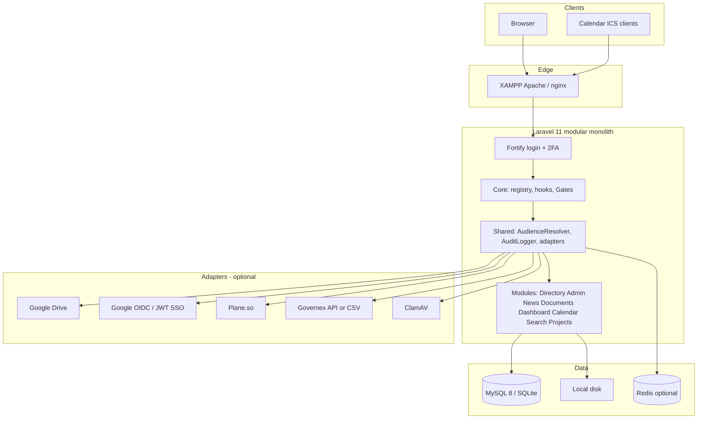

# OJ Solutions Intranet — Technical Documentation

**As-built system reference** for the OJ Solutions Intranet Portal.

| Field | Value |
|-------|--------|
| Product | OJ Solutions Intranet Portal |
| Architecture | Laravel 11 modular monolith |
| Document type | Technical (as implemented) |
| Related specs | OJ-INTRA-IMP-001, OJ-INTRA-URD-001, OJ-INTRA-ARC-001, OJ-INTRA-DS-001, OJ-INTRA-CHK-001 |
| Primary codebase | `app/Core`, `app/Modules`, `app/Shared` |

This document describes **what the application actually does today**. Where the original architecture spec (OJ-INTRA-ARC-001) differs from the running code, the difference is called out in [§20 As-built vs original architecture](#20-as-built-vs-original-architecture).

**Companion pages**

| Page | Use |
|------|-----|
| [Documentation index](README.md) | All docs in `docs/` |
| [Developer handbook](DEVELOPER.md) | Add a module, ACL, adapters, tests |
| [Runtime flows](FLOWS.md) | Sequence diagrams (install, auth, documents, search, sync) |
| [HTTP route catalogue](ROUTES.md) | Named routes, middleware, permissions |

---

## Table of contents

1. [Purpose](#1-purpose)
2. [System overview](#2-system-overview)
3. [Technology stack](#3-technology-stack)
4. [Runtime environments](#4-runtime-environments)
5. [Architectural principles](#5-architectural-principles)
6. [Repository layout](#6-repository-layout)
7. [Application bootstrap](#7-application-bootstrap)
8. [Module system](#8-module-system)
9. [Request lifecycle and middleware](#9-request-lifecycle-and-middleware)
10. [Authentication and identity](#10-authentication-and-identity)
11. [Authorisation](#11-authorisation)
12. [Shared kernel](#12-shared-kernel)
13. [Feature modules](#13-feature-modules)
14. [Integrations and adapters](#14-integrations-and-adapters)
15. [Data model](#15-data-model)
16. [Search](#16-search)
17. [User interface and design system](#17-user-interface-and-design-system)
18. [Security and privacy](#18-security-and-privacy)
19. [Installer](#19-installer)
20. [As-built vs original architecture](#20-as-built-vs-original-architecture)
21. [Operations](#21-operations)
22. [Quality, tests, and CI](#22-quality-tests-and-ci)
23. [Configuration reference](#23-configuration-reference)
24. [Related documents](#24-related-documents)

---

## 1. Purpose

The intranet is the internal staff portal for OJ Solutions. It provides:

- Staff directory, org chart, profiles, and staff information (including sensitive HR/bank fields)
- Company news and alerts
- Document library with versioning, policy acknowledgements, and optional Google Drive mirroring
- Personalised dashboard
- Company calendar with ICS export
- ACL-aware unified search
- Unified project list (Plane, Governex, and manual)
- Admin: users, departments, permissions, branding, integrations, GDPR exports

It is a **single deployable** (modular monolith). Feature modules live under `app/Modules/` with hard boundaries. External systems are reached only through **adapter interfaces**.

---

## 2. System overview



Layered view (same system):

```text
Browser (XAMPP Apache or nginx)
        │
        ▼
Laravel 11  ── Fortify (local login + 2FA)
        │
        ├── Core        ModuleRegistry, hooks, Gate binding
        ├── Shared      AudienceResolver, AuditLogger, Settings, adapters
        └── Modules     Directory, Admin, News, Documents, Dashboard,
                        Calendar, Search, Projects, Demo
        │
        ├── MySQL 8 or SQLite
        ├── Redis (optional; file/sync used locally)
        ├── Local disk  (documents, profiles, branding)
        └── Optional: Google Drive, Google OIDC, Plane.so, Governex, ClamAV, Meilisearch
```

**Request path (typical authenticated page):**

1. Apache Alias `/intranet` → `public/index.php` (or vhost `intranet.local`).
2. `RedirectIfNotInstalled` — first-run wizard if `storage/app/installed` is missing.
3. `SecureHeaders` — CSP, HSTS, frame/nosniff policies.
4. Fortify session auth + `EnsureSessionIsActive` (active flag + idle timeout).
5. Route `can:<permission>` and/or Eloquent policy.
6. Controller (thin) → Service → Model / adapter.
7. Blade + Livewire, tokens from DS-001.

Health endpoint: `GET /up`.

---

## 3. Technology stack

| Layer | Choice |
|-------|--------|
| Language | PHP 8.2+ (CI uses 8.3; Composer `platform.php` is 8.2.12) |
| Framework | Laravel 11 |
| Auth | Laravel Fortify (`registration` disabled) |
| RBAC | `spatie/laravel-permission` |
| UI | Blade, Livewire 4, Alpine.js (via Livewire), Tailwind CSS 3 |
| Design | OJ-INTRA-DS-001 tokens (`oj-*`, `ink-*`, `paper-*`, `signal-*`) |
| Assets | Vite 6; CSS fallback `public/css/oj.css` |
| Database | MySQL 8 or SQLite (default local/installer) |
| Cache / session / queue | File / database / `sync` locally; Redis available via Docker |
| Search | In-app ACL search; `meilisearch/meilisearch-php` present, Scout **not** wired |
| HTML sanitisation | HTMLPurifier |
| Spreadsheets | PhpSpreadsheet (staff import) |
| Tests | Pest 3 + Laravel plugin |
| Static analysis | PHPStan / Larastan — level 6 app, level 8 `app/Core` |
| Style | Laravel Pint (PSR-12) |
| CI | GitHub Actions (`.github/workflows/ci.yml`) |

Composer package name: `oj-solutions/intranet` (proprietary).

---

## 4. Runtime environments

### 4.1 Local — XAMPP Apache (primary)

Documented in the repository `README.md`.

| Mode | URL | Config |
|------|-----|--------|
| Subdirectory | `http://localhost/intranet` | `apache/alias.conf` included from XAMPP `httpd-vhosts.conf` |
| Virtual host | `http://intranet.local` | `apache/vhost.conf` + hosts file |
| Installer | `http://localhost/intranet/install` | First-run wizard |

`APP_URL` must match the chosen mode. Without the Alias, `/intranet/install` 404s because Apache does not map the subdirectory to `public/`.

### 4.2 Optional Docker Compose

`docker-compose.yml` is for production-parity services, not day-to-day development:

| Service | Port |
|---------|------|
| App (PHP 8.3-fpm) | via nginx |
| nginx | 8080 |
| MySQL | 3307 |
| Redis | default |
| Meilisearch | 7700 |
| Mailpit | SMTP + UI |

PHP image: `docker/php/Dockerfile`. Nginx: `docker/nginx/default.conf`.

### 4.3 Target production (spec)

OJ-INTRA-ARC-001 describes CloudFront + WAF, ALB + nginx, ECS (min two tasks / two AZs), RDS MySQL 8, Redis 7, Meilisearch, S3, Secrets Manager, AWS eu-west-2. Local and current CI run on Apache/SQLite (or MySQL) without that edge stack.

---

## 5. Architectural principles

These are enforced in code and in `.cursor/skills/oj-intranet/SKILL.md`:

1. **Adapter-mediated externals** — modules depend on interfaces (`DriveBroker`, `SsoAdapter`, `PlaneAdapter`, `GovernexAdapter`, `DocumentStorageAdapter`, `VirusScanner`). They must not import vendor SDKs directly.
2. **Single authorisation authority** — Spatie permissions + Laravel policies + `AudienceResolver`. Google Groups are not used for ACL.
3. **Degrade, never fail** — Drive uploads always land on local disk first; Drive mirror is best-effort. Project sync uses a circuit breaker and staleness flags instead of hard errors.
4. **Modular monolith** — one deployable; features isolated under `app/Modules/{Name}`.
5. **Audit what matters** — `Auditable` trait plus explicit `AuditLogger` calls for logins, downloads, permission changes, GDPR exports.
6. **Design tokens only from DS-001** — Tailwind maps CSS variables; modules must not invent colours or radii.

**Controller rule:** keep actions short; business logic lives in Services. Form Requests for complex validation (currently `StoreStaffInformationRequest`). Policies for model-level authorisation.

---

## 6. Repository layout

```text
app/
├── Actions/Fortify/          # Create/update/reset user (Fortify contracts)
├── Console/Commands/         # intranet:sync-integrations, gdpr-prune, progress
├── Core/                     # Module registry + hooks (no business logic)
│   ├── Hooks/                # HookManager, Hook facade
│   └── Modules/              # ModuleRegistry, ModuleManifest, ModuleServiceProvider
├── Http/
│   ├── Controllers/          # Install, SSO callback, Drive OAuth
│   └── Middleware/           # Install, session, admin, security headers
├── Models/User.php           # Canonical user (not under Shared)
├── Modules/                  # Feature modules (see §13)
├── Providers/                # App, Core, Fortify
└── Shared/
    ├── Adapters/             # SSO, Drive, Plane, Governex drivers
    ├── Contracts/            # Adapter interfaces
    ├── Models/               # Department, Team, AuditLog, Settings-related
    ├── Security/             # ClamAV / null virus scanner
    ├── Services/             # Audience, audit, settings, branding, installer, …
    └── Support/Auditable.php

bootstrap/
├── app.php                   # Routing, middleware aliases, /up
└── providers.php             # App + Core + Fortify

config/                       # fortify, permission, integrations, gdpr, filesystems, …
database/
├── migrations/
└── seeders/                  # Role, Directory, Phase2–4, DemoContent
docs/                         # This file, ops, UAT, security, phase 6
public/                       # Front controller, oj.css fallback
resources/views/              # App shell, auth, dashboard, install
routes/
├── web.php                   # Install, SSO, Drive OAuth, /dashboard, /admin
└── console.php               # Scheduler
tests/Feature/                # Phase 0–5 + installer + staff information
apache/                       # alias.conf, vhost.conf
```

Each feature module follows:

```text
app/Modules/{Name}/
├── module.json               # Metadata (label, version) — not loaded by the registry
├── {Name}ServiceProvider.php
├── Http/Controllers/
├── Http/Requests/            # Optional
├── Livewire/
├── Models/
├── Policies/
├── Services/
└── Resources/views/
```

---

## 7. Application bootstrap

`bootstrap/providers.php` registers only:

1. `App\Providers\AppServiceProvider`
2. `App\Providers\CoreServiceProvider`
3. `App\Providers\FortifyServiceProvider`

There is **no** filesystem auto-discovery of `app/Modules/*`. `CoreServiceProvider::register()` is the module loader:

1. Bind singletons: `HookManager`, `ModuleRegistry`, `AuditLogger`, `Settings`, `Branding`, integration adapters, `AudienceResolver`, `HtmlSanitizer`, `Analytics`, `IntegrationHealthService`, `VirusScanner`.
2. Register `ModuleServiceProvider` (Gates + enabled-module views/migrations).
3. Register feature providers in this order:

`Demo` → `Directory` → `Admin` → `News` → `Documents` → `PoliciesMenu` → `Dashboard` → `Calendar` → `Search` → `Projects`

`AppServiceProvider` forces file session/cache and `sync` queue when the app is **not** installed (and not running tests), so the installer can run on a blank environment.

`Settings::applyToConfig()` maps stored keys onto Laravel config (`site_name` → `app.name`, privacy contact → `gdpr.privacy_contact`). Failures are swallowed when the `settings` table does not exist yet.

---

## 8. Module system

### 8.1 Registration

Each module’s `boot(ModuleRegistry $registry)` calls:

```php
$registry->register('directory')
    ->permissions([
        'directory.view' => 'View staff directory',
        // …
    ])
    ->menu(['label' => 'Directory', 'route' => 'directory.index', 'order' => 10, 'permission' => 'directory.view'])
    ->views(__DIR__.'/Resources/views', 'directory');
```

`ModuleManifest` also supports `migrations($path)`. `ModuleServiceProvider` loads views and migrations only for **enabled** modules.

`module.json` is human/metadata only. Enablement is **not** read from that file.

### 8.2 Enable / disable

Table `modules`: `name` (unique), `version`, `is_enabled`, `config` JSON.

`ModuleRegistry::isEnabled($name)` reads `modules.is_enabled` (cached 60 seconds). If the table is missing (install/migrate), it falls back to the in-memory manifest default.

When disabled:

- Menu entries disappear.
- Permissions for that module are omitted from `allPermissions()`.
- Views/migrations for that module are not loaded by `ModuleServiceProvider`.
- Controllers typically `abort_unless($registry->isEnabled('…'), 404)`.

**Caveat:** HTTP routes are still registered at boot for most modules. Only Demo aborts inside the route closure. Treat disable as “hidden and 404 on use”, not “unregistered router”.

Sidebar: `resources/views/layouts/app.blade.php` calls `ModuleRegistry::menuItems()` and further filters by `auth()->user()->can($item['permission'])`.

### 8.3 Permissions as Gates

`ModuleServiceProvider::registerPermissions()` defines a Laravel Gate for every enabled module permission. The Gate delegates to Spatie `hasPermissionTo`.

DB rows are **not** created on every boot. Seeders call `ModuleServiceProvider::syncPermissions($registry)` (`Permission::findOrCreate`).

### 8.4 Hooks

`HookManager` provides WordPress-style `addAction` / `addFilter` / `action` / `filter` (priority-sorted). Facade: `App\Core\Hooks\Hook`.

Infrastructure exists for client overlays (`app/Modules/Custom/` in the architecture spec). **No feature module currently registers or fires hooks.** Safe to use; unused in production paths.

---

## 9. Request lifecycle and middleware

Registered in `bootstrap/app.php`.

| Alias / append | Class | Behaviour |
|----------------|-------|-----------|
| web append | `RedirectIfNotInstalled` | Redirect to installer unless `storage/app/installed` exists (exceptions: `install/*`, `/up`) |
| web append | `SecureHeaders` | CSP, HSTS (HTTPS), XFO, nosniff, Referrer-Policy, Permissions-Policy |
| `admin` | `EnsureUserIsAdmin` | `hasRole('Admin')` or 403 |
| `session.active` | `EnsureSessionIsActive` | `is_active` must be true; idle timeout from Settings `session_idle_timeout` (default 480 minutes) |
| `install.guest` | `PreventInstallWhenInstalled` | Blocks installer after lock file |
| `role` / `permission` / `role_or_permission` | Spatie | Standard Spatie middleware |

Typical module route group:

```php
Route::middleware(['web', 'auth', 'session.active'])->group(function () {
    Route::get('/directory', …)->middleware('can:directory.view')->name('directory.index');
});
```

Fortify named limiters (see `FortifyServiceProvider`):

| Limiter | Rate |
|---------|------|
| `login` | 5 / minute |
| `two-factor` | 5 / minute |
| `downloads` | 60 / minute (`throttle:downloads`) |
| `search` | 120 / minute (`throttle:search`) |

---

## 10. Authentication and identity

### 10.1 Local credentials (always on)

Fortify (`config/fortify.php`):

- Guard `web`, username `email`, home `/dashboard`
- **Registration off** — users are pre-provisioned (admin UI, CSV import, or seeder)
- Features: password reset, profile/password update, **two-factor authentication** (confirm + confirmPassword)
- Login event writes `audit_logs` action `login`

Demo / seed accounts (password `password` unless the installer set otherwise):

| Email | Role |
|-------|------|
| `admin@oj.local` | Admin |
| `staff@oj.local` | Staff |

Directory seeder also creates additional demo people (manager, jasmine, ade, etc.).

### 10.2 MFA / TOTP

`User` uses Fortify’s `TwoFactorAuthenticatable`. Challenge view: `resources/views/auth/two-factor-challenge.blade.php`.

There is **no dedicated in-app Blade UI** for enabling or rotating 2FA beyond Fortify’s built-in routes/challenge. Admin MFA enforcement on staging is still a Gate 0 manual item.

### 10.3 SSO adapter

Config: `config/integrations.php` → `SSO_DRIVER` = `local` | `jwt` | `google_oidc`.

| Driver | Class | Role |
|--------|-------|------|
| `local` | `LocalCredentialsDriver` | Default; local Fortify login |
| `jwt` | `JwtSsoDriver` | JWT handshake (`SSO_JWT_SECRET`); JTIs stored in `sso_jtis` |
| `google_oidc` | `GoogleOidcDriver` | Google Workspace OIDC |

Callback: `GET /sso/callback/{provider}` → `SsoCallbackController`.

Rules:

- User must already exist (`email` match) and `is_active`.
- Unrecognised accounts are refused (no JIT provisioning).
- Provider `local` is rejected on this route.
- Successful SSO is audited as `sso.login`.

Local credentials remain available as break-glass even when SSO is configured.

### 10.4 Sessions and deprovision

- `users.is_active` — inactive users cannot keep a session (`EnsureSessionIsActive`).
- Admin can deactivate / reactivate and terminate sessions (`UserAdminService`).
- Idle timeout: Settings key `session_idle_timeout` (minutes).
- Workspace Directory reconcile every 15 minutes is **specified** in ARC-001; this codebase does **not** yet poll Google Directory for deprovision.

---

## 11. Authorisation

Authorisation is layered. All layers must pass.

### 11.1 Roles (Spatie)

Seeded in `database/seeders/RoleSeeder.php`. Teams feature in Spatie config is **off**.

| Role | Permissions |
|------|-------------|
| **Admin** | All module permissions |
| **Manager** | All except keys starting with `admin.` |
| **Staff** | View-only allow-list: `demo.view`, `directory.view`, `news.view`, `documents.view`, `policies.view`, `dashboard.view`, `calendar.view`, `search.view`, `projects.view` |
| **Guest** | None |

Admin pages additionally require middleware `admin` (`hasRole('Admin')`), not only a permission.

### 11.2 Permission catalogue

| Module | Permissions |
|--------|-------------|
| demo | `demo.view` |
| directory | `directory.view`, `directory.import`, `directory.manage` |
| admin | `admin.users.manage`, `admin.departments.manage`, `admin.permissions.manage`, `admin.settings.manage`, `admin.integrations.view`, `admin.quick_links.manage`, `admin.compliance.export` |
| news | `news.view`, `news.publish`, `news.manage` |
| documents | `documents.view`, `documents.upload`, `documents.manage`, `policies.view`, `policies.manage` |
| dashboard | `dashboard.view` |
| calendar | `calendar.view`, `calendar.manage` |
| search | `search.view` |
| projects | `projects.view`, `projects.manage` |

The Policies **menu** module registers no permissions of its own; it uses Documents’ `policies.*`.

The Admin permission matrix Livewire UI (`admin.permission-matrix`) lets Admins change role ↔ permission assignments at runtime.

### 11.3 Model policies

| Policy | Model | Typical rules |
|--------|-------|----------------|
| `PostPolicy` | News `Post` | `news.view` + published (unless manage) + `isVisibleTo` |
| `DocumentPolicy` | `Document` | `documents.*` + visibility / audience |
| `CalendarEventPolicy` | `CalendarEvent` | `calendar.view` + audience; manage via `calendar.manage` |
| `ProjectPolicy` | `Project` | `projects.view` + visibility; manage via `projects.manage` |

### 11.4 Audience JSON (content ACL)

Shared shape on news posts, documents, calendar events, projects:

```json
{
  "departments": [1, 4],
  "teams": [],
  "roles": ["Staff"],
  "users": []
}
```

`App\Shared\Services\AudienceResolver`:

- `null` or empty object / all-empty arrays → **company-wide** (allow).
- Otherwise **OR** across named users, roles, departments, teams.
- `normalize()` is the only supported writer of this shape.

Models expose `isVisibleTo(User $user)` which delegates to the resolver (plus publication/trash rules where relevant). Search **must** apply the same checks at query time — never “index then hide in the view”.

---

## 12. Shared kernel

`User` lives at `app/Models/User.php` (traits: `HasRoles`, `TwoFactorAuthenticatable`, `Auditable`).

### 12.1 Domain models

| Model | Path | Notes |
|-------|------|--------|
| `Department` | `app/Shared/Models/Department.php` | Tree (`parent_id`), lead, users pivot (`is_lead`, `job_title`), teams |
| `Team` | `app/Shared/Models/Team.php` | Belongs to department |
| `UserProfile` | `app/Shared/Models/UserProfile.php` | Photo, phone, bio, expertise tags |
| `AuditLog` | `app/Shared/Models/AuditLog.php` | Morph `auditable`; no `updated_at` |
| `AnalyticsEvent` | `app/Shared/Models/AnalyticsEvent.php` | Named events (dashboard view, search, …) |
| `DriveConnection` | `app/Shared/Models/DriveConnection.php` | Encrypted OAuth tokens |
| `IntegrationHealth` | `app/Shared/Models/IntegrationHealth.php` | Circuit breaker rows |

### 12.2 Services

| Service | Responsibility |
|---------|----------------|
| `AudienceResolver` | Content ACL (see §11.4) |
| `AuditLogger` | `log($action, $auditable, $old, $new, $userId)` |
| `Auditable` trait | Auto `created` / `updated` / `deleted` |
| `Settings` | Key/value JSON store, 300s cache, `applyToConfig()` |
| `Branding` | Logo, favicon, accent CSS from Settings |
| `Installer` | Wizard, migrate, foundation seed, lock file |
| `Analytics` | `track($name, $payload, $userId)` |
| `HtmlSanitizer` | HTMLPurifier for news body |
| `CircuitBreaker` | Retry 3× exponential backoff; open after 5 failures; half-open after 60s; writes `integration_health` |
| `IntegrationHealthService` | Admin snapshot of adapters |
| `SubjectAccessExporter` | GDPR subject-access pack |
| `AuditExporter` | Streamed audit CSV |

### 12.3 User graph

```text
User
 ├── profile (UserProfile)
 ├── staffInformation (StaffInformation)     Directory module
 ├── roles / permissions (Spatie)
 ├── departments (pivot department_user)
 ├── teams (pivot team_user)
 ├── manager / directReports (manager_id)
 ├── dashboard prefs, ICS token
 └── 2FA secret / recovery codes (hidden)
```

---

## 13. Feature modules

### 13.1 Directory

Staff directory, org chart, profiles, CSV/XLSX import, staff information form.

| Item | Detail |
|------|--------|
| Permissions | `directory.view`, `directory.import`, `directory.manage` |
| Menu | Directory → `directory.index` (order 10) |
| Livewire | `directory.index`, `directory.org-chart`, `directory.profile-edit`, `directory.staff-import` |

**Routes**

| Name | Method | URI |
|------|--------|-----|
| `directory.index` | GET | `/directory` |
| `directory.org-chart` | GET | `/directory/org-chart` |
| `directory.department` | GET | `/directory/departments/{department:slug}` |
| `directory.show` | GET | `/directory/people/{user}` |
| `directory.profile.edit` | GET | `/directory/profile/edit` |
| `directory.import` | GET | `/directory/import` |
| `directory.staff-information.edit` | GET | `/directory/staff-information` |
| `directory.staff-information.update` | POST | `/directory/staff-information` |
| `directory.staff-information.cv` | GET | `/directory/staff-information/cv` |

**Staff information** (`StaffInformation` + `StaffInformationService`):

- Personal details, next of kin, job, LinkedIn, photo, CV.
- Bank `account_number` and `sort_code` use Laravel `encrypted` casts (ciphertext in MySQL/SQLite).
- `staff_can_edit` — Admins can lock the record; owner then receives 403 on update.
- Admins edit via `/admin/users/{user}/staff-information`.
- Files stored on the `public` disk under `profiles/{id}/` and `staff-information/{id}/`.

**Import:** `StaffImportService` preview + commit for CSV/XLSX.

**Search:** `DirectorySearch` — paginated filters, fuzzy name match, expertise tags.

### 13.2 Admin

No sidebar registry item; reached from the app chrome / `/admin`. Extra `admin` role middleware on most routes.

| Permission | Area |
|------------|------|
| `admin.users.manage` | User list/create/edit, deactivate, staff information |
| `admin.departments.manage` | Department tree CRUD |
| `admin.permissions.manage` | Permission matrix |
| `admin.settings.manage` | Site name, idle timeout, branding uploads |
| `admin.integrations.view` | Health + manual project sync |
| `admin.quick_links.manage` | Dashboard quick links |
| `admin.compliance.export` | Subject-access export, audit CSV |

Livewire: user index/form, department manager, permission matrix, quick links, site settings, Drive credentials.

Also: privacy notice (`GET /privacy`), Drive OAuth connect/disconnect (routes in `web.php`).

### 13.3 News

| Permissions | `news.view`, `news.publish`, `news.manage` |
| Menu | News → `news.index` (order 20) |
| Livewire | `news.feed`, `news.composer` |

Posts: draft / in_review / published; pin and alert banner; audience JSON; HTML body sanitised; attachments and inline images; read receipts (`post_reads`).

`NewsService` owns create, publish, feed-for-user, alert banner, mark-read.

### 13.4 Documents and Policies

Documents module owns storage, versions, trash, search-in-body, and the **policy hub**. A thin `PoliciesMenuServiceProvider` only adds the sidebar entry (order 35, `policies.view`).

| Permissions | `documents.view`, `documents.upload`, `documents.manage`, `policies.view`, `policies.manage` |
| Livewire | `documents.browser`, `documents.upload`, `documents.policy-hub` |

**Document lifecycle**

1. Upload: extension allow-list → virus scan → SHA-256 checksum (duplicate warning) → `DocumentStorageAdapter::put` → version 1 → audit `document.uploaded`.
2. New version: `newVersion`, bump `version_number`, update `current_version_id`.
3. Restore version: new current pointer (does not destroy history).
4. Trash / restore: `trashed_at` (soft delete path).
5. Download: policy + `isVisibleTo`; audit `document.downloaded` or `document.download_denied`; bytes from adapter `get()` (local cache). Rate limited.

Allowed extensions: `pdf`, `doc`, `docx`, `xls`, `xlsx`, `ppt`, `pptx`, `txt`, `csv`, `md`.

**Policies:** documents with `is_policy`. Mandatory acknowledgement tracked per user/version. Compliance CSV export for managers.

**Storage adapter:** `GoogleDriveStorageDriver` always writes **local** first, then mirrors to Drive when the broker is connected. Listings and ACL never call Drive. See [§14.2](#142-document-storage-and-drive).

### 13.5 Dashboard

Home is `GET /dashboard` in `routes/web.php` (app layout). Module registers widgets and `GET /dashboard/prefs`.

`WidgetRegistry` permission-gates widgets:

- Announcements (news)
- My documents
- Upcoming events
- Policy acknowledgements
- Quick links
- My projects
- New joiners (directory)

Prefs stored in `user_dashboard_prefs.widgets` JSON.

`QuickLink` supports internal `route:name` hrefs or external URLs; `staff_visible` flag.

### 13.6 Calendar

Native MySQL calendar (not a Google Calendar adapter).

| Permissions | `calendar.view`, `calendar.manage` |
| Livewire | `calendar.board`, `calendar.event-form` |

Events: title, category/colour, start/end, all-day, location, audience, optional `rrule`, attendees + RSVP.

ICS:

- Authenticated download `GET /calendar/export.ics`
- Per-user token on `users.ics_token`; public feed `GET /calendar/feed/{token}.ics`

### 13.7 Search

See [§16](#16-search). Menu order 5. Suggest endpoint throttled.

### 13.8 Projects

Unified list from Plane, Governex, and manual entry.

| Permissions | `projects.view`, `projects.manage` |
| Livewire | `projects.index`, `projects.form` |

`Project`: `source`, `external_ref` (unique per source), RAG, `deep_link`, `metrics` JSON, `synced_at`, audience. `isStale()` uses `PROJECT_STALENESS_MINUTES` (default 60) for Plane/Governex rows.

`ProjectSyncService::syncAll()` pulls both adapters (circuit breaker). Scheduled every 15 minutes. Admin can trigger `POST /admin/integrations/sync`.

### 13.9 Demo

Gate 0 proof of the module system. Permission `demo.view`, menu order 90. `GET /demo` 404s when disabled.

---

## 14. Integrations and adapters

Bindings: `CoreServiceProvider::registerIntegrations()` and `DocumentsServiceProvider` for storage.

### 14.1 Identity (`SsoAdapter`)

See [§10.3](#103-sso-adapter). Health reported on Admin → Integrations.

### 14.2 Document storage and Drive

```text
Documents module
    └── DocumentStorageAdapter
            └── GoogleDriveStorageDriver
                    ├── LocalStorageDriver     always
                    └── DriveBroker            optional mirror
                            ├── GoogleDriveOAuthDriver
                            └── LocalDriveBroker (no-op)
```

`DRIVE_BROKER_ENABLED` plus client id/secret selects `GoogleDriveOAuthDriver`; otherwise `LocalDriveBroker`.

Admin connects a Google account (OAuth) via:

- `GET /integrations/drive/connect`
- `GET /integrations/drive/callback`
- `POST /integrations/drive/disconnect`

Tokens are encrypted on `drive_connections`. `DriveBroker::resolve()` is the intended “fetch revision into cache if missing” path. **Downloads in `DocumentService` currently read the local `storage_ref`**, so the degrade path is “serve local cache”; uncached Drive-only files would need `resolve()` before `get()`.

Microsoft OneDrive is explicitly unsupported.

### 14.3 Plane (`PlaneAdapter`)

| Config | Behaviour |
|--------|-----------|
| `PLANE_DRIVER=http` + URL + API key | `PlaneHttpDriver` |
| otherwise | `PlaneFakeDriver` (deterministic demo data) |

Used only by `ProjectSyncService`. Modules must not call Plane HTTP APIs directly.

### 14.4 Governex (`GovernexAdapter`)

| Config | Behaviour |
|--------|-----------|
| `GOVERNEX_DRIVER=api` + URL + key | `GovernexApiDriver` |
| otherwise | `GovernexCsvDriver` (`GOVERNEX_CSV_PATH`) |

Same interface either way — CSV is the fallback, not a special case in the Projects module.

### 14.5 Virus scanner (`VirusScanner`)

| `VIRUS_SCANNER` | Class |
|-----------------|-------|
| `clamav` | `ClamAvScanner` (`CLAMAV_HOST` / `CLAMAV_PORT`) |
| `null` (default) | `NullVirusScanner` (always clean) |

Invoked on document upload before bytes are stored.

### 14.6 Circuit breaker

`CircuitBreaker` (`app/Shared/Services/CircuitBreaker.php`):

- Max 3 attempts, exponential backoff (`usleep` 100ms × 2^(n-1))
- Open after 5 consecutive failures
- Half-open after 60 seconds
- Persists to `integration_health` (`status`, `circuit`, `failure_count`, `last_success_at`, …)

Admin UI shows this snapshot; project widgets surface staleness when `synced_at` is older than the configured threshold.

---

## 15. Data model

### 15.1 Entity relationship (logical)

```text
users ── user_profiles
      ── staff_information
      ── model_has_roles ── roles ── permissions
      ── department_user ── departments (parent_id)
      ── team_user ── teams
      ── manager_id (self)

posts ── post_reads
      ── post_attachments

document_categories (tree)
documents ── document_versions (current_version_id)
          ── document_acknowledgements

calendar_events ── event_attendees
projects ── project_milestones

audit_logs · settings · modules
user_dashboard_prefs · quick_links · analytics_events
search_zero_results · integration_health · drive_connections · sso_jtis
```

### 15.2 Tables (migrations)

All under `database/migrations/`. Highlights:

| Area | Tables |
|------|--------|
| Laravel | `users`, `password_reset_tokens`, `sessions`, `cache`, `jobs`, `failed_jobs` |
| Platform | `modules`, `audit_logs`, `settings` |
| Auth | Spatie permission tables, Fortify 2FA columns, `passkeys` |
| Directory | `departments`, `teams`, pivots, `user_profiles`, `staff_information` |
| News | `posts`, `post_reads`, `post_attachments` |
| Documents | `document_categories`, `documents`, `document_versions`, `document_acknowledgements` |
| Phase 3 | `user_dashboard_prefs`, `analytics_events`, `calendar_events`, `event_attendees`, `search_zero_results`; `users.ics_token` |
| Phase 4 | `integration_health`, `sso_jtis`, `projects`, `project_milestones`, `quick_links`, `drive_connections` |

**Encrypted at rest (app-level):** `staff_information.account_number`, `staff_information.sort_code`, `drive_connections.access_token`, `drive_connections.refresh_token` (Laravel `encrypted` casts; `APP_KEY`).

**Notable uniques:** `staff_information.user_id`, `projects (source, external_ref)`, `document_versions` checksum indexed for duplicate detection.

### 15.3 Seeders

`DatabaseSeeder` → `RoleSeeder` → `DirectorySeeder` → `Phase2Seeder` → `Phase3Seeder` → `Phase4Seeder`.

`DemoContentSeeder` is the installer “Load demo data” path (does not overwrite existing passwords).

---

## 16. Search

`App\Modules\Search\Services\SearchService`.

**Indexed types:** `posts`, `documents`, `users`, `departments`, `events`, `projects`.

**Behaviour:**

1. Permission check (`search.view` plus type-specific view permissions).
2. SQL `LIKE` / in-app scoring when Meilisearch is not used.
3. Each hit filtered with the same visibility rules as the owning module (`isVisibleTo`, published, not trashed).
4. Optional facets: type, department.
5. Zero-result queries logged to `search_zero_results`.
6. Analytics event `search.performed`.

**HTTP**

| Name | URI | Notes |
|------|-----|--------|
| `search.index` | `GET /search` | Full page (Livewire) |
| `search.suggest` | `GET /search/suggest` | JSON typeahead; `throttle:search`; target &lt; 500ms |

`aclTokens()` exists for future Meilisearch filter strings. Laravel Scout is **not** a dependency; `.env.example` still lists `SCOUT_DRIVER` / `MEILISEARCH_*` for the intended later wiring. Docker Compose includes Meilisearch v1.11 for that future path.

---

## 17. User interface and design system

Source of truth: `05_Design_System.html` (OJ-INTRA-DS-001). Implementation notes: `.cursor/skills/oj-intranet/reference/design-system.md`.

- Layout: `resources/views/layouts/app.blade.php` — sidebar from `ModuleRegistry::menuItems()`, branding from `Branding`, theme via `data-theme-resolved`.
- Tailwind `theme.extend.colors` maps CSS variables (`--oj-900`, `--ink-900`, `--paper-0`, status `ok` / `warn` / `err` / `info`, `signal`).
- Fonts: Archivo (UI), Newsreader (voice), JetBrains Mono.
- Dark mode: selector `[data-theme-resolved="dark"]`, not OS `prefers-color-scheme` alone.
- Livewire 4 components per module; Alpine for small client behaviour.
- Vite in local CSP allow-list (`localhost:5173`) so HMR works under XAMPP.

Modules must not hard-code hex colours or new radii.

---

## 18. Security and privacy

### 18.1 Browser hardening

`SecureHeaders` (every web response):

- `X-Frame-Options: SAMEORIGIN`
- `X-Content-Type-Options: nosniff`
- `Referrer-Policy: strict-origin-when-cross-origin`
- `Permissions-Policy: camera=(), microphone=(), geolocation=()`
- `Content-Security-Policy` — `default-src 'self'`; Google Fonts; local Vite in `local`
- `Strict-Transport-Security` when the request is HTTPS or `APP_URL` is `https://`

Detail: `docs/security/headers-and-rate-limits.md`.

### 18.2 Application controls

- CSRF on all Fortify/web forms (Laravel default).
- Authorisation: permissions + policies + audience (see §11).
- Downloads and search throttled.
- Upload MIME/extension allow-list + virus scan hook.
- News HTML sanitised (`HtmlSanitizer`).
- Staff bank details encrypted at rest.
- Drive OAuth tokens encrypted at rest.
- Audit log for state changes, logins, downloads, permission matrix, GDPR export.
- `intranet:gdpr-prune` daily 02:30 — retention from `config/gdpr.php` (audit 730 days, sessions 30, search zeros 90, SSO JTIs 7 by default).
- Subject-access export for a named user (Admin compliance).
- Privacy notice page; contact from Settings / `GDPR_PRIVACY_CONTACT`.

### 18.3 Secrets

Never commit `.env`. Production should use environment / Secrets Manager for `APP_KEY`, DB, SSO, Drive, Plane, Governex. Demo passwords in seeders are for local/UAT only.

---

## 19. Installer

Lock file: `storage/app/installed`.

| Step | Route | Action |
|------|-------|--------|
| 1 Requirements | `GET/POST /install` | PHP extensions, writable paths |
| 2 Database | `GET/POST /install/database` | SQLite or MySQL, write `.env`, migrate |
| 3 Admin | `GET/POST /install/admin` | Create admin; optional demo seed |
| 4 Complete | `GET /install/complete` | Confirmation; installer locked |

Middleware `install.guest` prevents re-entry after lock. `RedirectIfNotInstalled` sends everyone else to the wizard.

If Apache 500s before the wizard: `public/server-check.php` and `C:\xampp\apache\logs\error.log`. `AH00124` usually means Alias/RewriteBase misconfiguration.

---

## 20. As-built vs original architecture

Honest deltas against OJ-INTRA-ARC-001 / the skill’s condensed architecture:

| Spec | As built |
|------|----------|
| Laravel Scout + Meilisearch query-time ACL filters | In-app SQL search; Meilisearch client library present; `aclTokens()` prepared |
| Horizon queues (`default`, `sync`, `index`, `mail`) | `QUEUE_CONNECTION=sync` locally; jobs table exists; **no Horizon**; `app/Jobs` empty |
| `CalendarAdapter` (Google Calendar source of truth) | Native `CalendarEvent` + ICS only |
| `IdentityProvider` name | Implemented as `SsoAdapter` |
| `ProjectSourceAdapter` | Split into `PlaneAdapter` + `GovernexAdapter` |
| `S3StorageDriver` | Not present; local disk is the cache |
| Document download: S3 checksum cache → Drive fetch → 5 min signed URL | Local `get(storage_ref)`; Drive used as **upload mirror**; `DriveBroker::resolve()` exists for cache fill |
| Google Directory reconcile every 15 min | Not implemented; manual deactivate + session kill |
| In-app 2FA enrolment UI / Admin MFA enforce | Fortify 2FA columns + challenge; enrolment UI / staging enforce still manual Gate items |
| Hook-driven custom overlays | Hook API exists; unused by modules |
| `module.json` drives registry | Metadata only; PHP `ServiceProvider` + `modules` table |
| Disable module unregisters routes | Menu/permissions/404; routes still registered (except Demo abort) |

These are implementation choices or remaining work, not accidental omissions in this document.

---

## 21. Operations

### 21.1 Scheduled commands

`routes/console.php` (requires `php artisan schedule:run` from cron / Task Scheduler):

| Command | Schedule | Purpose |
|---------|----------|---------|
| `intranet:sync-integrations` | every 15 minutes | Plane + Governex upsert |
| `intranet:gdpr-prune` | daily 02:30 | Retention purge |

Also: `intranet:progress` / `intranet:progress --write` validates the agent skill and regenerates `docs/IMPLEMENTATION_PROGRESS.md`.

### 21.2 Deploy

See `docs/ops/deploy-runbook.md`. Short path:

1. `php artisan down`
2. Deploy artefact / `git pull`
3. `composer install --no-dev --optimize-autoloader`
4. `php artisan migrate --force`
5. `php artisan config:cache && php artisan route:cache && php artisan view:cache`
6. Restart scheduler (and queue workers if `QUEUE_CONNECTION` is not `sync`)
7. `php artisan up`
8. Smoke `/login`, search, a document download, `/admin`

Health: `GET /up`.

### 21.3 Backup and restore

- DB: RDS snapshot or `mysqldump` / SQLite file copy.
- Storage: `storage/app` (documents, private uploads, branding).
- Restore drill template: `docs/ops/restore-drill-template.md`.
- Rollback: `docs/migration/rollback.md`.

### 21.4 Content migration

Source → destination map: `docs/migration/taxonomy.md`.

---

## 22. Quality, tests, and CI

### 22.1 Commands

```bash
vendor/bin/pint
vendor/bin/phpstan analyse -c phpstan.neon          # app, level 6
vendor/bin/phpstan analyse -c phpstan-core.neon     # Core, level 8
vendor/bin/pest
php artisan intranet:progress --write
```

Composer scripts: `test`, `analyse`, `lint`, `progress`.

### 22.2 Feature tests

| File | Covers |
|------|--------|
| `InstallerTest` | Wizard, SQLite install, demo seed, lock |
| `Phase0FoundationTest` | Registry, hooks, roles, login audit, admin ACL |
| `Phase1DirectoryTest` | Browse, search, profile, import preview, deactivate, matrix |
| `DepartmentAdminTest` | Department CRUD; staff forbidden |
| `Phase2NewsDocumentsTest` | News XSS/audience, document versions/ACL/trash/checksum, policy ack |
| `Phase3DashboardSearchTest` | Widgets, calendar ICS/audience, search ACL/typeahead/zero-results |
| `Phase4IntegrationsTest` | Projects RAG/staleness, SSO, Drive, Plane, health, quick links |
| `Phase5HardeningTest` | Headers, IDOR, virus scanner, GDPR export, settings, prune |
| `StaffInformationTest` | Encrypted bank fields, uploads, admin lock `staff_can_edit` |

CI (`.github/workflows/ci.yml`): Pint `--test`, PHPStan both configs, `npm ci && npm run build`, Pest on SQLite `:memory:` for `push`/`pull_request` on `main` and `develop`.

**Convention:** a Pest feature test should exist for each `UR-*` before marking the requirement done.

---

## 23. Configuration reference

Keys from `.env.example` (no secret values):

| Group | Keys |
|-------|------|
| App | `APP_NAME`, `APP_ENV`, `APP_KEY`, `APP_DEBUG`, `APP_URL` |
| Database | `DB_CONNECTION`, `DB_HOST`, `DB_PORT`, `DB_DATABASE`, `DB_USERNAME`, `DB_PASSWORD` |
| Session / cache / queue | `SESSION_*`, `CACHE_*`, `QUEUE_CONNECTION`, `REDIS_*` |
| Mail | `MAIL_*` |
| Files | `FILESYSTEM_DISK`, `AWS_*` |
| Search (future) | `SCOUT_DRIVER`, `MEILISEARCH_HOST`, `MEILISEARCH_KEY` |
| SSO | `SSO_DRIVER`, `SSO_JWT_SECRET`, `GOOGLE_OIDC_*` |
| Drive | `DRIVE_BROKER_ENABLED`, `GOOGLE_DRIVE_*` |
| Projects | `PLANE_*`, `GOVERNEX_*`, `PROJECT_STALENESS_MINUTES` |
| Security / GDPR | `VIRUS_SCANNER`, `CLAMAV_*`, `GDPR_*` |

Runtime settings (DB `settings` table) include `session_idle_timeout` and `site_name` / branding; Admins change these in **Admin → Settings** without a deploy.

---

## 24. Related documents

| Document | Path / ID |
|----------|-----------|
| Docs index | [`docs/README.md`](README.md) |
| Developer handbook | [`docs/DEVELOPER.md`](DEVELOPER.md) |
| Runtime flows | [`docs/FLOWS.md`](FLOWS.md) |
| HTTP routes | [`docs/ROUTES.md`](ROUTES.md) |
| README (local setup) | `README.md` |
| Implementation plan | OJ-INTRA-IMP-001 · `01_Implementation_Plan (1).md` |
| User requirements | OJ-INTRA-URD-001 · `02_User_Requirements_Document.md` |
| Phase gates | OJ-INTRA-CHK-001 · `03_Phase_Gate_Verification_Checklist.md` |
| Architecture spec | OJ-INTRA-ARC-001 · `04_System_Architecture.md` |
| Design system | OJ-INTRA-DS-001 · `05_Design_System.html` |
| Agent playbook | `.cursor/skills/oj-intranet/SKILL.md` |
| Phase 6 plan | `docs/phase6/IMPLEMENTATION_PLAN.md` |
| Generated progress | `docs/IMPLEMENTATION_PROGRESS.md` |
| Deploy runbook | `docs/ops/deploy-runbook.md` |
| Security headers | `docs/security/headers-and-rate-limits.md` |
| UAT personas | `docs/uat/` |
| Hypercare | `docs/adoption/hypercare.md` |

Requirement IDs (`UR-*`) map to phases in `.cursor/skills/oj-intranet/reference/requirements-map.md`.
